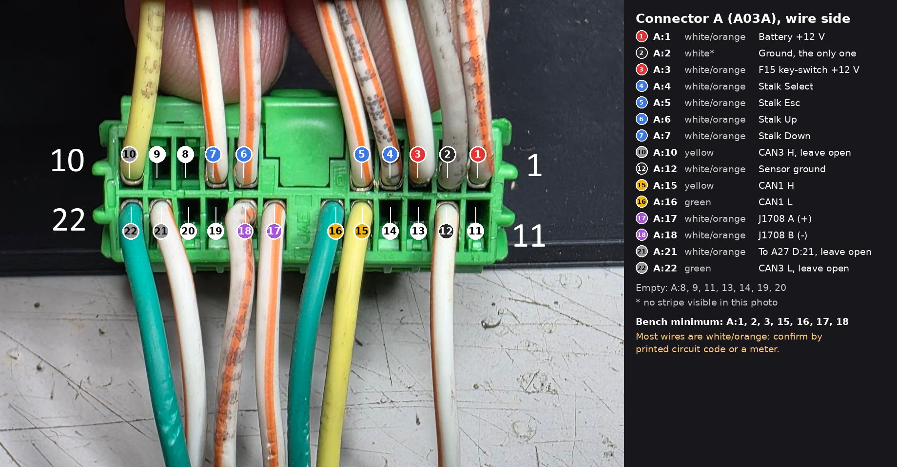
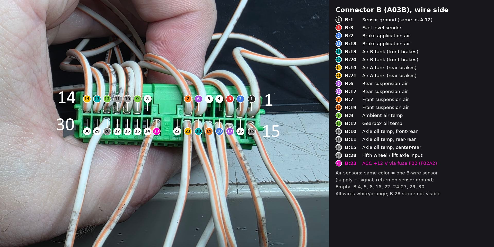
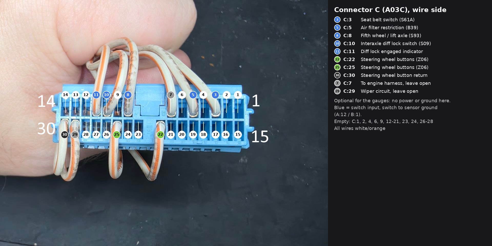

# Harness connectors

Photos of the mating harness for cluster 21844839-P01, annotated against
[pinout.md](pinout.md). All three views are from the **wire side** (the
side the wires enter), with cavity 1 at the top right. The molded cavity
numbers on connector C agree with this numbering.

Every cavity that the wiring diagram uses has a wire, and every wire sits in
a cavity the diagram uses. The only surprise was B:23, which turned out to be
the ACC feed (see below).

## Identifying wires

Nearly every wire is **white with an orange stripe**, so color doesn't tell
you which pin a wire is. The only exceptions are the CAN pairs on connector A,
which follow Volvo's colors: **yellow = CAN H, green = CAN L**.

To identify any other wire, read the circuit code printed on its insulation
(for example `F20A3`, `HB3A1`), or ring it out with a meter from the cavity.
Do this for A:1, A:2, A:3 and B:23 before the first power-up.

## Connector A (A03A): green, 22 cavities

| Pin | Wire color | Code | Function | Bench |
|---|---|---|---|---|
| A:1 | white/orange | F20A3 | Battery +12 V | +12 V |
| A:2 | white (no stripe visible) | X03DA17 | Ground, the only one | Ground |
| A:3 | white/orange | F15D10 | F15 key-switch battery feed | +12 V |
| A:4 | white/orange | HA4A1 | Stalk Select | Button to +12 V |
| A:5 | white/orange | HA5A1 | Stalk Esc | Button to +12 V |
| A:6 | white/orange | HA6A1 | Stalk Up | Button to +12 V |
| A:7 | white/orange | HA7A1 | Stalk Down | Button to +12 V |
| A:10 | yellow | DL3HB17 | CAN3 H | Leave open |
| A:12 | white/orange | HA12A1 | Sensor ground | Sensor return |
| A:15 | yellow | DL1HN3 | J1939 CAN1 H | Transceiver CANH |
| A:16 | green | DL1LN3 | J1939 CAN1 L | Transceiver CANL |
| A:17 | white/orange | DL4HN15 | J1708 A (+) | XY-485 A |
| A:18 | white/orange | DL4LN15 | J1708 B (−) | XY-485 B |
| A:21 | white/orange | PD21A1 | To module A27 D:21 | Leave open |
| A:22 | green | DL3LB17 | CAN3 L | Leave open |

Empty: A:8, 9, 11, 13, 14, 19, 20.

## Connector B (A03B): green, 30 cavities

All wires are white/orange.

| Pin | Code | Function | Bench |
|---|---|---|---|
| B:1 | HA12A7 | Sensor ground (same as A:12) | Sensor return |
| B:2 / B:18 | HB2A1 / HB18A1 | Brake application air pressure (B06AP) | Supply + signal |
| B:3 | HB3A1 | Fuel level sender (B07) | Resistance to sensor ground |
| B:6 / B:17 | HB6A1 / HB17A1 | Rear suspension air pressure (B58R) | Supply + signal |
| B:7 / B:19 | HB7A1 / HB19A1 | Front axle suspension air pressure (B56) | Supply + signal |
| B:9 | HB9A1 | Ambient air temperature (B22A) | Resistance to sensor ground |
| B:10 | HB10A1 | Rear axle oil temp, front-rear | Optional |
| B:11 | HB11A1 | Rear axle oil temp, rear-rear | Optional |
| B:12 | HB12A1 | Gearbox oil temperature (B09) | Resistance to sensor ground |
| B:13 / B:20 | HB13A1 / HB20A1 | Air pressure B-tank, front brakes (B06A) | Supply + signal |
| B:14 / B:21 | HB14A1 / HB21A1 | Air pressure A-tank, rear brakes (B06B) | Supply + signal |
| B:15 | HB15A1 | Rear axle oil temp, center-rear | Optional |
| B:23 | F02A2 | **ACC +12 V** through fuse F02 (radio fuse) | +12 V on a switch |
| B:28 | F63C1 | Fifth wheel / lift axle indicator (S88) | Optional |

Empty: B:4, 5, 8, 16, 22, 24–27, 29, 30.

B:23 was missing from the first read of the diagram. Its printed code was
worn down to the last digits, so it was traced on the diagram: it comes from
the ACC rail through F02. See "Key position" in [pinout.md](pinout.md).

## Connector C (A03C): blue, 30 cavities

All wires are white/orange. None of connector C is needed for the gauges.

| Pin | Code | Function | Bench |
|---|---|---|---|
| C:3 | HC3A1 | Seat belt switch (S61A) | Optional: switch to sensor ground |
| C:5 | HC5A1 | Air filter restriction switch (B39) | Optional: switch to sensor ground |
| C:7 | HC7A1 | To engine harness | Leave open |
| C:8 | F63E1 | Fifth wheel / lift axle circuit (S93) | Optional: switch to sensor ground |
| C:10 | F27E1 | Interaxle diff lock switch (S09) | Optional: switch to sensor ground |
| C:11 | HC11A1 | Diff lock engaged indicator | Optional: switch to sensor ground |
| C:22 / C:25 | HC22A1 / HC25A1 | Steering wheel buttons (Z06) | Optional menu buttons |
| C:29 | HC29A1 | Wiper circuit | Leave open |
| C:30 | HC30A1 | Steering wheel button return | With C:22 / C:25 |

Empty: C:1, 2, 4, 6, 9, 12–21, 23, 24, 26–28.

The codes in these tables come from the wiring diagram, not from the photos.
Most of the printed codes on this harness are worn and hard to read.
