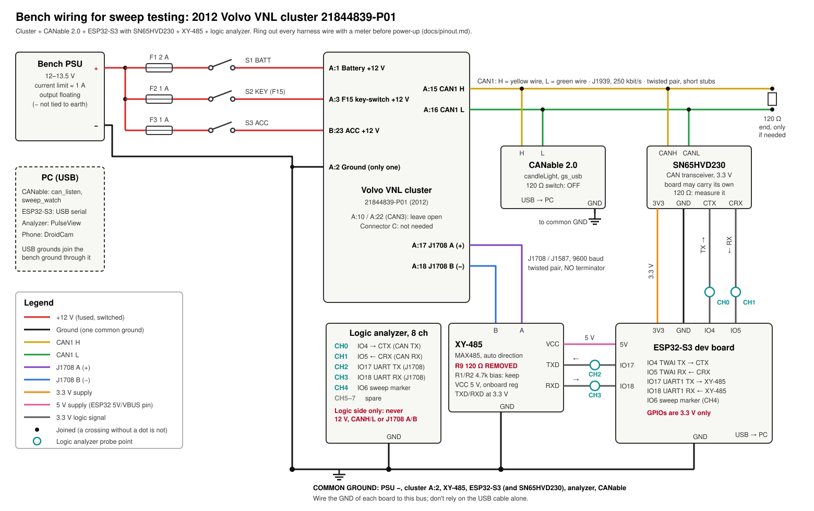

# Bench wiring for sweeps

How the cluster, the CANable 2.0, the ESP32-S3 with its SN65HVD230, the
XY-485 and the logic analyzer connect on the bench. Cluster pins come from
[pinout.md](pinout.md) and [harness.md](harness.md); ring out every harness
wire with a meter before the first power-up.

## Power

| From | Through | To | Notes |
|---|---|---|---|
| PSU + | F1 2 A, switch S1 BATT | A:1 battery +12 V | |
| PSU + | F2 1 A, switch S2 KEY | A:3 F15 key-switch +12 V | |
| PSU + | F3 1 A, switch S3 ACC | B:23 ACC +12 V | Its own switch, so key off and key at ACC can be simulated |
| PSU − | | A:2 ground | The cluster's only ground |

Bench supply at 12–13.5 V with the current limit around 1 A. The fuse
values are a starting guess sized above what the cluster should draw; the
current limit is the real protection. Power-up order is A:2, A:1, A:3, then
B:23 ([pinout.md](pinout.md#first-power-up)).

## CAN1 (J1939, 250 kbit/s)

| Cluster | CANable 2.0 | SN65HVD230 |
|---|---|---|
| A:15 CAN H (yellow) | H | CANH |
| A:16 CAN L (green) | L | CANL |
| | GND to common ground | GND to ESP32 GND |

Use twisted pair and keep the stubs to the CANable and the transceiver short.

**Termination:** a CAN bus wants exactly two 120 Ω resistors, one at each
end. With everything wired and the power off, measure CAN H to CAN L:

- About 60 Ω: done.
- About 120 Ω: only one terminator is present. Add a 120 Ω at the far end, or
  turn on the CANable's termination switch.
- About 40 Ω or less: too many. Most SN65HVD230 boards carry their own 120 Ω
  (often marked R2, "121"), and the cluster may have one inside. Turn the
  CANable's switch off or lift the board's resistor until you read 60 Ω.

The CANable's termination switch starts OFF in the diagram.

## J1708 / J1587 (9600 baud)

| Cluster | XY-485 |
|---|---|
| A:17 J1708 A (+) | A |
| A:18 J1708 B (−) | B |

Twisted pair, **no** terminator: remove R9 (120 Ω, "121") from the XY-485
and keep the 4.7 kΩ bias resistors R1/R2 ([parts.md](parts.md#notes-on-the-j1708-transceiver)).

## ESP32-S3

| ESP32-S3 | To | Signal |
|---|---|---|
| 3V3 | SN65HVD230 3V3 | 3.3 V supply |
| GND | SN65HVD230 GND, common ground | |
| GPIO4 | SN65HVD230 CTX | TWAI TX |
| GPIO5 | SN65HVD230 CRX | TWAI RX |
| 5V (VBUS) | XY-485 VCC | 5 V supply |
| GPIO17 | XY-485 TXD | UART1 TX |
| GPIO18 | XY-485 RXD | UART1 RX |
| GND | XY-485 GND, common ground | |
| GPIO6 | logic analyzer CH4 only | Sweep marker, once firmware toggles it |

Everything on the ESP32 side is 3.3 V logic. The SN65HVD230 runs from 3.3 V.
The XY-485 is fed 5 V and its onboard regulator brings the MAX485 down to
3.3 V, so its TXD and RXD are 3.3 V too. Never put 5 V on an ESP32-S3 GPIO.

The pins are a suggestion: the TWAI controller and UART1 can use almost any
GPIO. These avoid the strapping pins (0, 3, 45, 46), native USB (19, 20) and
the flash and PSRAM pins (26–37). The firmware in step 3 will use the same
pins.

Notes:

- Board labels for TXD and RXD on these RS-485 modules aren't consistent. If
  no bytes arrive, swap GPIO17 and GPIO18.
- Until firmware sets up the TWAI controller, GPIO4 floats and the
  transceiver could hold the bus dominant. While sweeping from the CANable
  with no ESP32 firmware, unplug the SN65HVD230 from CAN H/L, or pull CTX up
  to 3.3 V with 10 kΩ.
- J1708 reaches the PC through the ESP32, which needs a small UART-to-USB
  passthrough sketch. Until then, a 3.3 V USB-serial adapter can take the
  ESP32's place on the XY-485 (VCC 5 V, TXD, RXD, GND) for `j1708_listen.py`.

## Logic analyzer (8 channels)

| Channel | Probe | What you see |
|---|---|---|
| CH0 | GPIO4 / CTX | CAN frames the ESP32 sends |
| CH1 | GPIO5 / CRX | Everything on CAN1, including the cluster |
| CH2 | GPIO17 / XY-485 TXD | J1708 bytes the ESP32 sends |
| CH3 | GPIO18 / XY-485 RXD | J1708 bytes on the bus |
| CH4 | GPIO6 | Sweep marker from the firmware, to line captures up with candidates |
| CH5–7 | spare | |
| GND | common ground | |

Probe the 3.3 V logic side only, never the 12 V lines, CAN H/L or J1708 A/B.
In PulseView, decode CH1 as CAN at 250 kbit/s and CH3 as UART at 9600 8N1.

## Common ground

PSU −, cluster A:2, the CANable, the SN65HVD230, the XY-485, the ESP32-S3 and
the analyzer all share one ground. Wire each board's GND to the bench ground
rather than relying on the USB cables. Keep the bench supply's output
floating (− not strapped to earth) so the PC's USB ground and the supply
don't fight.
